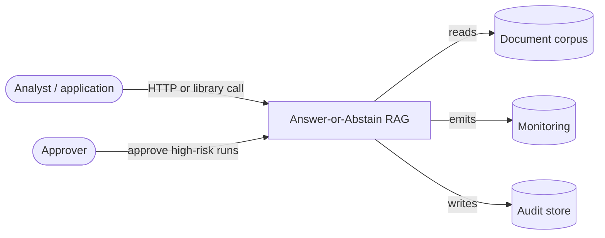

# System context (C4 level 1)

| Actor | Interaction |
|---|---|
| Caller | Submits a query with a principal and optional pre-retrieved candidates |
| Approver | Releases runs that touch restricted material |
| Corpus | Supplies candidates when the caller sends none |
| Monitoring | Scrapes `/metrics`, consumes logs and traces |
