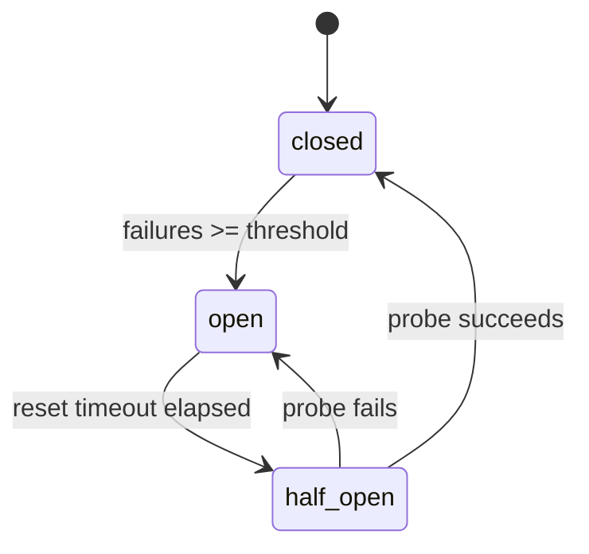

# Resilience

| Role | On failure |
|---|---|
| `ingest` | Run fails; the request never reaches retrieval. |
| `retrieve` | Run degrades; supplied candidates (if any) continue. |
| `enrich` | Run degrades; candidates continue without annotations. |
| `cache` | Run degrades; the request is treated as a cache miss. |
| `score` | Run degrades; fallback restores upstream prior order. |
| `fallback` | Run degrades; ordering from the last healthy stage is kept. |
| `policy` | Run fails closed: no candidates survive, the run abstains with `policy_unavailable`. |
| `budget` | Run degrades; the answer stage still applies `top_k`. |
| `approval` | Run fails; nothing is released without an approval decision. |
| `audit` | Run degrades; the answer is still returned and the gap is visible in metrics. |
| `answer` | Run fails with `stage_failure:<name>`. |
